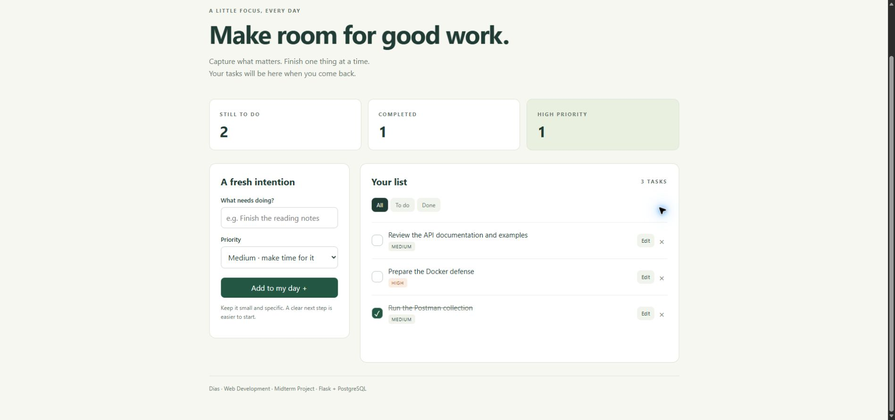
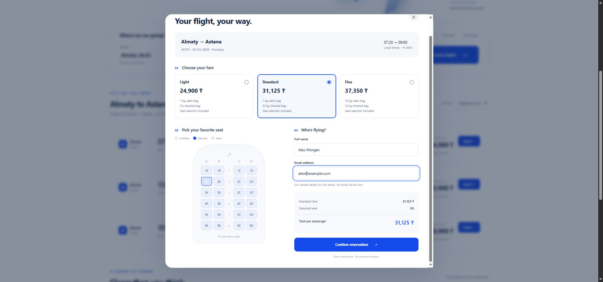

# Aeron — A little further.

A flight reservation application built with **FastAPI, SQLAlchemy and PostgreSQL**, with a responsive browser interface and a reproducible Docker Compose environment. Web Development Midterm · Dias.

Search routes, compare three fares, choose a seat, reserve a flight, edit passenger details, download an itinerary and cancel a reservation. The server protects seat inventory in PostgreSQL transactions, computes prices itself and supports safe request retries.

**Educational demo:** flights, cabin inventory and prices are synthetic. No real airline integration, payment, email delivery or ticket issuance. One passenger and one one-way flight per reservation. Use sample passenger details.



## Run

Requirements: Docker Desktop with Linux containers and Compose v2; Python 3.10+ for the credential generator and integration script. Python dependencies run inside Docker.

```sh
git clone --branch midterm-project https://github.com/dikos1705/web_dev.git aeron
cd aeron
python setup_env.py
docker compose up -d --build --wait
```

Open **http://localhost:8083**. Swagger: **http://localhost:8083/docs**. ReDoc: **http://localhost:8083/redoc**.

The submission ZIP includes working local `.env` settings: extract it and run `docker compose up -d --build --wait`. GitHub contains only `.env.example`; `setup_env.py` generates unique local secrets and preserves an existing `.env`. If port 8083 is occupied, change `APP_PORT` in `.env` before starting, or use `python setup_env.py --port 8084` before generating it.

Try **Almaty → Astana tomorrow**, choose any of the three departures, select Standard and a window seat, then enter `Alex Morgan` / `alex@example.com`. The confirmation opens My bookings. Bookings remain after browser reload and container recreation.

## Features

- Six airports: Almaty, Astana, Shymkent, Aktau, Dubai and Istanbul. Nine route/departure combinations each day for the next seven days are inserted at startup (63 flights on an empty database). Existing schedules and bookings are preserved; later restarts extend the demo horizon without replacing records.
- Search by origin, destination and departure date, with departure/price sorting. UI shows airport-local times, duration, available seats and KZT prices.
- Light, Standard and Flex fares include different baggage allowances. Price multipliers are 100%, 125% and 150%, rounded up to whole KZT. All fares allow cancellation in this demo; Flex refers to baggage, not a real airline refund contract.
- Interactive 24-seat demo cabin, with availability checked again during the database transaction.
- Passenger name/email updates, API seat changes, cancellation that releases inventory and deletion of cancelled records.
- Downloadable text itinerary with a clear demo disclosure.
- Flight CRUD and booking administration via protected API endpoints.
- Loading, empty, validation, transport and seat-conflict states; keyboard-accessible native dialogs and responsive layouts. Original SVG plane illustration; no frontend build step or external assets required.



## API and Postman

Complete endpoint guide: [docs/API.md](docs/API.md). Live generated contract: `/openapi.json`; exported copy: [docs/openapi.json](docs/openapi.json).

Import `postman/Aeron.postman_collection.json`. `setup_env.py` creates the ignored **`postman/Aeron.local.private.postman_environment.json`** containing your local admin key: import it and choose that environment. It is also included in the private submission ZIP. The public `Aeron.local.postman_environment.json` is a template: set its `adminKey` from your local `.env` if using it instead.

Run all 28 requests in order. They create their own flight and reservation, check the lifecycle and negative cases, then remove their records. Do not run the collection concurrently against the same server. For a terminal run, Compose supplies the local admin key without storing it in the collection:

```sh
docker compose --profile tools run --rm postman
```

The browser never receives the admin key. Flight writes and the booking list need `X-Admin-Key`. A reservation has its own `X-Booking-Token`, returned only by creation/replay. The browser stores that token and the booking ID locally. This is a small capability-based demo, without user accounts: losing browser storage loses the browser shortcut, and possession of a token grants management access. Keep local keys and tokens private. The `request_key` is also a private recovery key; reuse it only for the exact same creation request.

## Verification

```sh
python verify.py --persistence
docker compose --profile tools run --rm postman
```

The integration script checks real HTTP requests and PostgreSQL behavior: CRUD, validation, owner/admin access, fare calculation, idempotent retry, conflicting seats, **two simultaneous requests for one seat**, cancellation, seat reuse and persistence after `down` / `up`. It removes only its own temporary records. `--persistence` briefly restarts this Compose project; omit the option when you want to keep it running uninterrupted. GitHub Actions repeats these checks on branch pushes.

See [verification evidence](docs/VERIFICATION.md), machine-readable [results](docs/verification-results.json) and [defense notes in Russian](DEFENSE_RU.md).

## Structure and architecture

```text
Browser / Postman
       | localhost:8083 -> container:8000
FastAPI + static frontend (backend service, UID 10001)
       | database:5432, internal Compose network
PostgreSQL 17 (database service)
       | named volume: aeron-midterm_postgres-data
Persistent airports, flights and bookings
```

`backend/main.py` defines HTTP routes and dependencies; `schemas.py` validates inputs/outputs; `models.py` defines relational constraints; `services.py` owns prices and booking transactions; `security.py` checks keys; `seed.py` creates synthetic schedules. `frontend/` is dependency-free HTML/CSS/JavaScript.

Each write commits once or rolls back. All inventory mutations lock the flight row before the booking row, so creation, cancellation and seat changes serialize on that flight. A PostgreSQL partial unique index additionally forbids two confirmed bookings on the same flight/seat. Cancellation removes a record from that index without erasing its history. Flights with booking history cannot be changed or deleted. The server stores integer money, never accepts a client-provided total, and derives management tokens using HMAC with the local booking secret.

The database uses service DNS `database`, not `localhost`. Only the backend is published, bound to host loopback. Database readiness gates backend startup. The custom Dockerfile runs as a non-root user and copies only backend/frontend/requirements; local secrets are provided at runtime. The optional Postman service starts only with the tools profile.

## Useful commands

```sh
docker compose ps
docker compose logs --tail 100 backend
docker compose up -d --build --wait  # apply source changes
docker compose down                # retain database volume
docker compose up -d --wait         # reuse saved database
```

`docker compose down --volumes` deliberately erases this project's database. Do not use it when you need saved bookings. Keep `BOOKING_SECRET` stable when keeping the volume; changing it invalidates existing management tokens. Changing the PostgreSQL password in `.env` does not automatically change the password in an initialized database.

## Scope

This project is designed for a local coursework demonstration. For a public airline service, the next steps would include account-based authentication, TLS, abuse protection, managed secrets, schema migrations, monitoring and an actual inventory/payment integration. Database tables are initialized with SQLAlchemy `create_all` for this fixed demo schema. No production-readiness claim is made.

Submission: public repository branch link, source/Docker/API/Postman assets and the separate ZIP with working local environment files. The course portal's **Turn in** button must be pressed by the student.
